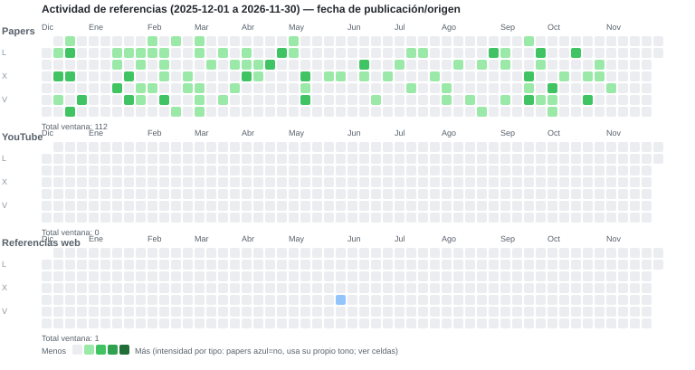

# Actividad de referencias (tipo contribution graph)

Rango completo de datos: **2017-11-07** a **2026-11-09** · 10 ventanas de 12 meses · 3 tipos apilados (Papers, YouTube, Referencias web).
Fecha usada = **publicación/origen** (ver nota en cada ventana). Navegación en la misma página disponible en el [README](../README.md#actividad-de-referencias-estilo-contribution-graph).

**Ventana actual (últimos 12 meses del rango): [2025-12 a 2026-11](ref_activity/2025-12_2026-11.md)**

## Todas las ventanas (rango completo)

- [2017-11 a 2017-11](ref_activity/2017-11_2017-11.md)
- [2017-12 a 2018-11](ref_activity/2017-12_2018-11.md)
- [2018-12 a 2019-11](ref_activity/2018-12_2019-11.md)
- [2019-12 a 2020-11](ref_activity/2019-12_2020-11.md)
- [2020-12 a 2021-11](ref_activity/2020-12_2021-11.md)
- [2021-12 a 2022-11](ref_activity/2021-12_2022-11.md)
- [2022-12 a 2023-11](ref_activity/2022-12_2023-11.md)
- [2023-12 a 2024-11](ref_activity/2023-12_2024-11.md)
- [2024-12 a 2025-11](ref_activity/2024-12_2025-11.md)
- [**2025-12 a 2026-11**](ref_activity/2025-12_2026-11.md) ← actual

[Dashboard](../reports/dashboard_latest.md) · [README](../README.md)
