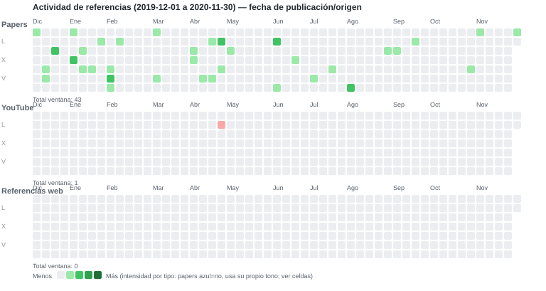

# Actividad de referencias — 2019-12 a 2020-11

[← 12 meses anteriores](2018-12_2019-11.md) | **2019-12 a 2020-11** (ventana 4/10) | [12 meses siguientes →](2020-12_2021-11.md)

- 3 mini-grids apiladas (Papers, YouTube, Referencias web), 12 meses por ventana.
- Fecha = **publicación/origen**: papers `published_at`; YouTube `published_at` (fallback `added_at`); web `source_date` (fallback `retrieved_at`, solo aceptadas/en observación).
- Rango completo cubierto por ventanas. Navega con las flechas (con límites al inicio/fin).

[Índice / ventana actual](../REFERENCE_ACTIVITY.md) · [Dashboard](../reports/dashboard_latest.md) · [README](../README.md)
