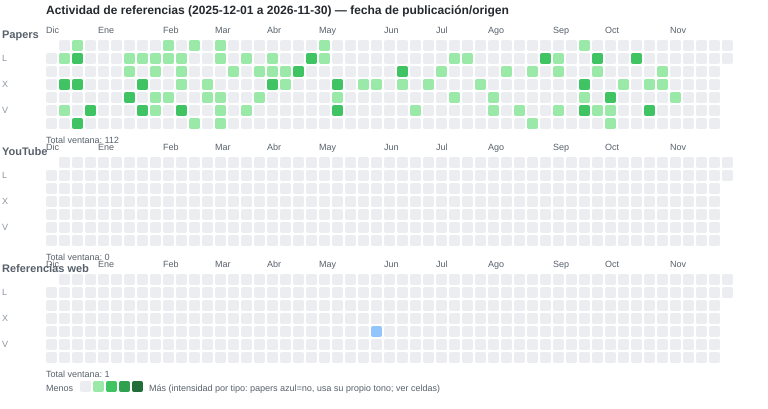

# Actividad de referencias — 2025-12 a 2026-11

[← 12 meses anteriores](2024-12_2025-11.md) | **2025-12 a 2026-11** (ventana 10/10) | 12 meses siguientes → *(límite final)*

- 3 mini-grids apiladas (Papers, YouTube, Referencias web), 12 meses por ventana.
- Fecha = **publicación/origen**: papers `published_at`; YouTube `published_at` (fallback `added_at`); web `source_date` (fallback `retrieved_at`, solo aceptadas/en observación).
- Rango completo cubierto por ventanas. Navega con las flechas (con límites al inicio/fin).

[Índice / ventana actual](../REFERENCE_ACTIVITY.md) · [Dashboard](../reports/dashboard_latest.md) · [README](../README.md)
